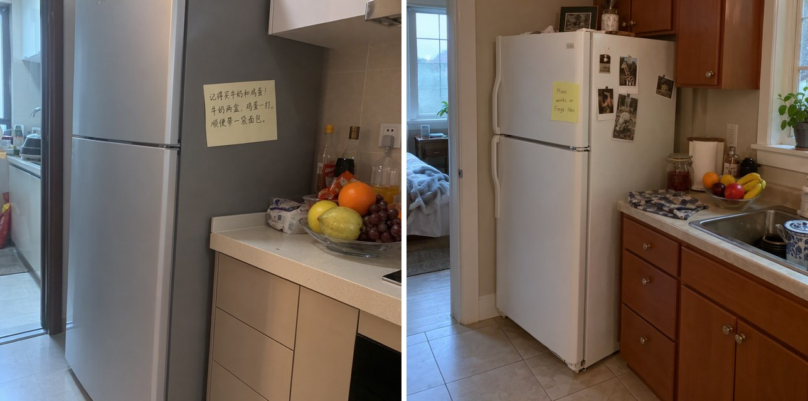
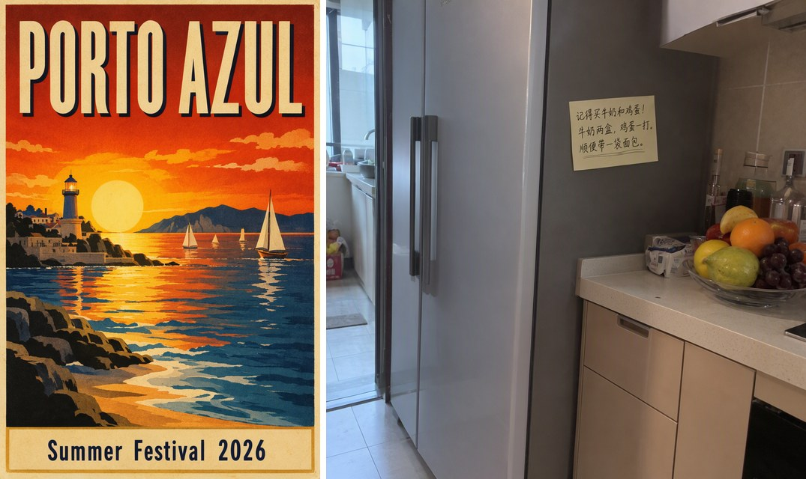

# 🖼️ MOSS-Image for Forge Neo

> **Extension for [Stable Diffusion WebUI Forge - Neo](https://github.com/Haoming02/sd-webui-forge-classic/tree/neo)**

Generate with **[MOSS-Image](https://huggingface.co/OpenMOSS-Team/MOSS-Image-SFT)** inside Forge Neo, using the checkpoint, preset and Generate button you already know - text-to-image with sharp text in English and Chinese.

> [!Important]
> This extension requires an up-to-date **Forge Neo** (the `neo` branch). On an older version it stays disabled and tells you so in the console - Forge Neo itself keeps working as usual.

---

## 📋 Table of Contents

- [What's New](#-whats-new)
- [Features](#-features)
- [Installation](#-installation)
- [Recommended Settings](#%EF%B8%8F-recommended-settings)
- [Tips](#-tips)
- [Credits](#-credits)

---

## 🆕 What's New

### v0.1.0 - First Release

- **MOSS-Image in Forge Neo** - OpenMOSS's text-to-image model, with its Qwen3.5 9B text encoder
- **moss** UI preset and **MOSS** schedule - upstream's settings, ready to generate
- **Upstream's guidance** - the negative pass skips block 22, as the official pipeline does, with a setting to change it

---

## 🎯 Features

### 🖼️ Native Generation

- Runs inside txt2img - no separate tab, no extra environment
- Works with the Forge Neo model folders and the **VAE / Text Encoder** selector you already use
- Uses the same autoencoder as FLUX.2 and FLUX 3 - if you have `flux2-vae`, you already have it
- Writes the text you put in quotes in the prompt, in English and in Chinese
- About a minute per 1024x1024 image at 50 steps on an A40 with the INT8 files

### 📝 Text and Posters

- Titles, captions and signs come out as written - put the exact words in quotes
- Any size that is a multiple of 16, such as 832x1248 for a poster

### 🧭 Upstream's Guidance

- The negative-prompt pass of CFG leaves out block 22 of the model, as the official pipeline does by default
- Change it under **Settings → Stable Diffusion → [MOSS-Image] Blocks skipped in the negative-prompt pass**: other blocks, comma-separated, or empty for plain CFG

### 🛡️ Safe by Design

- Changes no Forge Neo file - remove the extension and everything is as it was
- Checks your Forge Neo at startup and stays disabled if something it needs is missing
- Tells you which file is missing under **VAE / Text Encoder** instead of failing with a generic error
- Other models are not affected

---

## 📦 Installation

1. Open Forge Neo WebUI
2. Go to **Extensions** → **Install from URL**
3. Paste: `https://github.com/eduardoabreu81/moss-image-forge-neo`
4. Click **Install** and restart the WebUI
5. Download the files from [Comfy-Org/MOSS-Image](https://huggingface.co/Comfy-Org/MOSS-Image) and place them in the usual folders:

| Part | File | Folder |
| :--- | :--- | :--- |
| MOSS-Image checkpoint | `moss_image_sft_int8_convrot_attn` | `models/Stable-diffusion` |
| Qwen3.5 9B text encoder | `qwen3.5_9b_int8_convrot` | `models/text_encoder` |
| FLUX.2 autoencoder | `flux2-vae` | `models/VAE` |

6. Restart Forge Neo, so the new text encoder shows up in the list
7. Pick the **moss** UI preset, the checkpoint, and the text encoder and autoencoder under **VAE / Text Encoder**

> [!Note]
> Tested with the INT8 files of the SFT model, on an NVIDIA A40. The Base model and the BF16 files of the same repository have not been tested yet.

---

## ⚙️ Recommended Settings

| Sampler | Schedule type | Steps | CFG |
| :--- | :--- | :--- | :--- |
| Euler | MOSS | 50 | 3 |

The **moss** preset sets these values. Leave the **negative prompt** empty, and use sides that are a multiple of 16.

---

## 💡 Tips

- Write full captions - the scene, the objects, where they are, and the exact text in quotes
- Use Euler and the MOSS schedule; Simple gives nearly the same steps
- New text encoder files appear in the list after a restart of Forge Neo
- Before uninstalling, switch the UI preset to another one

---

## 📄 Credits

- **[Forge Neo](https://github.com/Haoming02/sd-webui-forge-classic/tree/neo)** by Haoming02
- **[MOSS-Image](https://github.com/OpenMOSS/MOSS-Image)** by the OpenMOSS Team - the model and its reference pipeline
- **[ComfyUI](https://github.com/comfyanonymous/ComfyUI)** by comfyanonymous and Comfy-Org - the Qwen3.5 implementation this port follows, and the INT8 files
- **[Qwen3.5](https://huggingface.co/Qwen)** by the Qwen team - the text encoder
- **[Transformers](https://github.com/huggingface/transformers)** by Hugging Face - the Qwen3.5 reference

The MOSS-Image weights are released by the OpenMOSS Team under the Apache License 2.0; this extension does not include them.

---

## 📜 License

AGPL-3.0 - see [LICENSE](LICENSE)

---

Made with ❤️ for the Stable Diffusion community

**[Report Bug](https://github.com/eduardoabreu81/moss-image-forge-neo/issues)** • **[Request Feature](https://github.com/eduardoabreu81/moss-image-forge-neo/issues)** • **[☕ Ko-fi](https://ko-fi.com/eduardoabreu81)**

