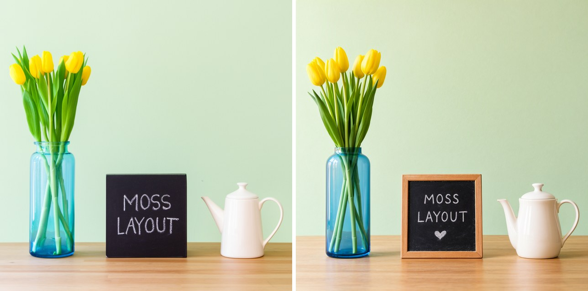
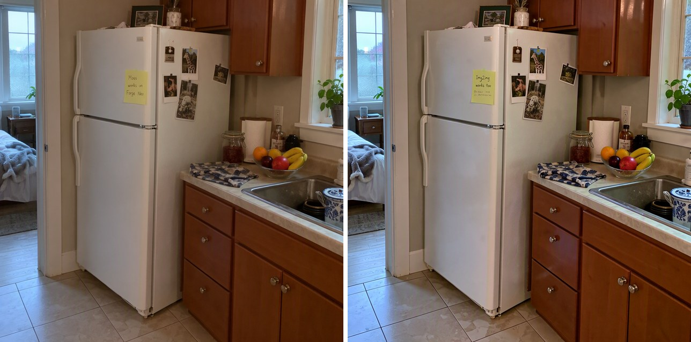

# 🖼️ MOSS-Image for Forge Neo

> **Extension for [Stable Diffusion WebUI Forge - Neo](https://github.com/Haoming02/sd-webui-forge-classic/tree/neo)**

Generate with **[MOSS-Image](https://huggingface.co/OpenMOSS-Team/MOSS-Image-SFT)** inside Forge Neo, using the checkpoint, preset and Generate button you already know - text-to-image with sharp text in English and Chinese, image-to-image, and layouts placed with boxes in the prompt.

> [!Important]
> This extension requires an up-to-date **Forge Neo** (the `neo` branch). On an older version it stays disabled and tells you so in the console - Forge Neo itself keeps working as usual.

---

## 📋 Table of Contents

- [What's New](#-whats-new)
- [Features](#-features)
- [Installation](#-installation)
- [Recommended Settings](#%EF%B8%8F-recommended-settings)
- [Tips](#-tips)
- [Credits](#-credits)

---

## 🆕 What's New

### v0.1.7 - INT4 Setting Moves to Its Own Extension

- **The INT4 setting now lives in [INT4 W4A8 for Forge Neo](https://github.com/eduardoabreu81/forge-neo-int4-w4a8)** - the same cleaner picture from the small INT4 checkpoints, now for every model with INT4 ConvRot files (Krea 2 included), not only MOSS-Image. Install it to keep the INT4 improvement ([details](#-int4-checkpoints))

### v0.1.6 - Layouts with LoRA Trigger Words

- **Layouts with a LoRA's trigger word after them** - with sd-dynamic-prompts on, a layout followed by a word such as a LoRA's trigger (`... "bbox_format":"yxyx" venusbody`), or by the commas a removed `<lora:...>` tag leaves, reached the model with its `{ }` still missing; the layout is now put back together and the words come right after it

### v0.1.5 - Cleaner INT4 Checkpoints

- **INT4 checkpoints look better** - the small community INT4 files now run with more precision by default, from the same file and in the same memory; a setting brings back the old way ([details](#-int4-checkpoints))

### v0.1.4 - Image Editing and Backend Choice

- **Edit pictures with an instruction** - the [MOSS Image Edit](https://huggingface.co/chinoll/Moss-Image-Edit) LoRA by chinoll works in img2img: give the picture, say what to change, and the rest stays ([how to use it](#%EF%B8%8F-image-editing)) ([#5](https://github.com/eduardoabreu81/moss-image-forge-neo/issues/5))
- **Extension or Forge built-in** - on Forge Neo 2.31 and newer, **Settings → Stable Diffusion → MOSS-Image → [MOSS-Image] Backend** picks who runs MOSS-Image checkpoints: the extension, or Forge Neo's own support. The change applies at the next generation, with no restart

### v0.1.3 - Forge Neo 2.31 and Faster Generation

- **Works with Forge Neo 2.31** - Forge Neo now has MOSS-Image support of its own, and loading a checkpoint failed with `unexpected keyword argument 'freq_dim'` ([#4](https://github.com/eduardoabreu81/moss-image-forge-neo/issues/4)). With the extension enabled, MOSS-Image checkpoints run on the extension; disable it to use Forge Neo's built-in support
- **About 2× faster** with comfy-kitchen - fused norm, RoPE and activation kernels by [RichyRich515](https://github.com/RichyRich515) ([#3](https://github.com/eduardoabreu81/moss-image-forge-neo/pull/3)): 16.7 s → 8.0 s per 1024×1024 picture on an RTX 4090

### v0.1.2 - Layouts with Dynamic Prompts

- **Layouts work with sd-dynamic-prompts installed** - it takes the `{ }` out of a JSON layout before the model reads it; MOSS-Image now puts them back, so the picture is the same as without it
- **Draw your layouts** - [Regional Boxes](https://github.com/eduardoabreu81/sd-regional-boxes-neo) 0.2.0 writes them for you: draw a box per thing or text, and the layout lands in the prompt

### v0.1.1 - Works Alongside Other Extensions

- **Plays well with other extensions** - the Forge check no longer disables MOSS-Image when another extension, such as FLUX 3, loads first and hooks the loader ([#1](https://github.com/eduardoabreu81/moss-image-forge-neo/issues/1))
- **8-step LoRA** - lodestones' LoRA works with the SFT model, pictures in 8 steps instead of 50 ([how to use it](#-8-step-lora))

### v0.1.0 - First Release

- **MOSS-Image in Forge Neo** - OpenMOSS's SFT and Base models, with their Qwen3.5 9B text encoder
- **Image-to-image** and **layouts by boxes** - put things where you want them with a JSON layout in the prompt
- **moss** UI preset and **MOSS** schedule - upstream's settings, ready to generate
- **Upstream's guidance** - the negative pass skips block 22, as the official pipeline does, with a setting to change it

---

## 🎯 Features

### 🖼️ Native Generation

- Runs inside txt2img and img2img - no separate tab, no extra environment
- Works with the Forge Neo model folders and the **VAE / Text Encoder** selector you already use
- Uses the same autoencoder as FLUX.2 and FLUX 3 - if you have `flux2-vae`, you already have it
- Writes the text you put in quotes in the prompt, in English and in Chinese
- About a minute per 1024x1024 image at 50 steps on an A40 with the INT8 files

### 📝 Text and Posters

- Titles, captions and signs come out as written - put the exact words in quotes
- Any size that is a multiple of 16, such as 832x1248 for a poster

### 📐 Layout by Boxes

- Tell the model where each thing goes: write the whole prompt as a JSON layout, in the format of [MOSS-Image's user guide](https://github.com/OpenMOSS/MOSS-Image/blob/main/USERGUIDE.md#layout-prompts-experimental)
- A `summary.caption` for the whole scene, then one item per thing with its `caption`, its `text` if it is writing, and its `bbox`
- Boxes are `[top, left, bottom, right]` in pixels from the center of the picture - on a 1024x1024 image both axes go from -512 to 512
- Works with the Base and the SFT model; give boxes that make sense in the scene - things placed where they could not stand tend to follow the caption instead
- Rather draw than type? [Regional Boxes](https://github.com/eduardoabreu81/sd-regional-boxes-neo) writes the layout from boxes drawn with the mouse
- Works with sd-dynamic-prompts on: the infotext shows the layout without its `{ }`, but the model gets it whole

### 🔁 Image-to-Image

- Put a picture in img2img and describe the result: with **Denoising strength** around 0.6 the scene stays and the details you change follow the prompt

### ✏️ Image Editing

- The [MOSS Image Edit](https://huggingface.co/chinoll/Moss-Image-Edit) LoRA by chinoll changes what you ask and keeps the rest of the picture: colors, clothes, lighting, seasons, style
- Download `adapter_model.safetensors`, rename it to something clearer such as `moss_image_edit.safetensors` and put it in `models/Lora`
- Turn on **Settings → Stable Diffusion → MOSS-Image → [MOSS-Image] Enable Reference** - pinning it to **Quicksettings** helps if you switch often
- In img2img, put the picture in, set **Denoising strength** to 1, and write the change as the prompt with the LoRA, for example `<lora:moss_image_edit:1>Change only the pink dress to bright red. Keep the character, face, hair, pose, background and composition unchanged.`
- Tested with Euler, MOSS, 30 steps, CFG 4, 1024x1024, the authors' settings
- The picture goes to the model scaled down to 512 on its long side, the default of the LoRA authors' ComfyUI node; change it under **Settings → Stable Diffusion → MOSS-Image → [MOSS-Image] Reference Maximum Side Length** - 0 means no limit: the picture goes in at the job's Width x Height
- Works with the [8-step LoRA](#-8-step-lora) too: add both LoRAs to the prompt and use 8 steps, CFG 1 - about a minute per 1024x1024 picture on an RTX 2070
- The LoRA was trained mostly on illustrations: on photos the change is made, but the rest of the scene is kept more loosely - the framing, the background or the object's shape can change
- More pictures can go in through **ImageStitch Integrated** (up to 4 in all), but in our test with two the result turned into a collage, and on an 8 GB card it took about ten times longer - one picture is what works today
- Turn the setting off for plain img2img - with it on, the img2img picture is a reference, not a starting point

### 🧭 Upstream's Guidance

- The negative-prompt pass of CFG leaves out block 22 of the model, as the official pipeline does by default
- Change it under **Settings → Stable Diffusion → MOSS-Image → [MOSS-Image] Blocks skipped in the negative-prompt pass**: other blocks, comma-separated, or empty for plain CFG
- OpenMOSS says blocks 22, 24 and 26 all help the picture, so `22, 24, 26` is worth a try
- Plain CFG looks more realistic, but some details can fall apart
- Forge Neo 2.31 also has **[Moss-Image] Skip Layer Guidance** settings: they apply when **[MOSS-Image] Backend** is set to Forge built-in, and do nothing while the extension runs the checkpoint
- Newer Forge Neo builds also have **[Moss-Image] Reference Method** for editing: the same split applies - it works with Forge built-in, while **[MOSS-Image] Enable Reference** and **Reference Maximum Side Length** work with the extension

### ⚡ 8-Step LoRA

- The 8-step LoRA from [lodestones](https://huggingface.co/lodestones/MOSS-Image-SFT-8-steps-dmd) works with the SFT model: pictures in 8 steps instead of 50, with no negative prompt pass
- Download `lora.safetensors`, rename it to something clearer such as `moss_8step.safetensors`, put it in `models/Lora` and add it to the prompt, for example `<lora:moss_8step:1>` - or use the LoRA tab as usual
- Set **Sampler** to Euler, **Schedule type** to MOSS (or Simple), **Steps** to 8 and **CFG** to 1
- It is a work in progress: the picture is sharp and the writing is readable, but fine details and text are a little less clean than with 50 steps. With 4 steps the picture came out washed out, so stay at 8
- If you prefer `lora_latest.safetensors`, the author recommends strength 0.7

### 🚀 4-Step LoRA

- The 4-step LoRA from [akhaliq](https://huggingface.co/akhaliq/MOSS-Image-SFT-4-steps) works with the SFT model: pictures in 4 steps, with no negative prompt pass - use it instead of the 8-step one, not together
- Download `lora.safetensors`, rename it to `MOSS-Image-SFT-4-steps.safetensors`, put it in `models/Lora` and add it to the prompt: `<lora:MOSS-Image-SFT-4-steps:1>`
- Set **Sampler** to Euler, **Schedule type** to MOSS, **Steps** to 4 and **CFG** to 1
- In our test the pictures came out coherent and the Chinese and English text was readable, a little softer than with 8 steps

### 🪶 INT4 Checkpoints

- The small INT4 ConvRot checkpoints shared by the community (about 3 GB, made for 8 GB cards) give a cleaner picture with **[INT4 W4A8 for Forge Neo](https://github.com/eduardoabreu81/forge-neo-int4-w4a8)**: same file, same memory, more precision
- It works with both choices of **[MOSS-Image] Backend**, and with other models that ship INT4 ConvRot files, such as Krea 2
- An INT4 file still loses some detail next to an INT8 one: if your card has room, the INT8 file of the same model gives the best picture

### 🛡️ Safe by Design

- Changes no Forge Neo file - remove the extension and everything is as it was
- Checks your Forge Neo at startup and stays disabled if something it needs is missing
- Tells you which file is missing under **VAE / Text Encoder** instead of failing with a generic error
- Other models are not affected

---

## 📦 Installation

1. Open Forge Neo WebUI
2. Go to **Extensions** → **Install from URL**
3. Paste: `https://github.com/eduardoabreu81/moss-image-forge-neo`
4. Click **Install** and restart the WebUI
5. Download the files from [Comfy-Org/MOSS-Image](https://huggingface.co/Comfy-Org/MOSS-Image) and place them in the usual folders:

| Part | File | Folder |
| :--- | :--- | :--- |
| MOSS-Image checkpoint | `moss_image_sft_int8_convrot` - or `moss_image_base_int8_convrot` for the Base model | `models/Stable-diffusion` |
| Qwen3.5 9B text encoder | `qwen3.5_9b_int8_convrot` | `models/text_encoder` |
| FLUX.2 autoencoder | `flux2-vae` | `models/VAE` |

6. Restart Forge Neo, so the new text encoder shows up in the list
7. Pick the **moss** UI preset, the checkpoint, and the text encoder and autoencoder under **VAE / Text Encoder**

> [!Note]
> Tested with the INT8 files of the SFT and Base models, on an NVIDIA A40 and an RTX A6000. The BF16 files of the same repository have not been tested yet. The 8-step LoRA and the editing LoRA were tested with the INT8 SFT model on an RTX 2070 (8 GB).

---

## ⚙️ Recommended Settings

| Sampler | Schedule type | Steps | CFG |
| :--- | :--- | :--- | :--- |
| Euler | MOSS | 50 | 3 |

The **moss** preset sets these values; change them on the **MOSS** page of **Settings** and the preset keeps yours. Leave the **negative prompt** empty with the SFT model; with the Base model, the user guide suggests `nsfw, worst quality, bad anatomy, watermark, jpeg artifact`. Use sides that are a multiple of 16.

---

## 💡 Tips

- Write full captions - the scene, the objects, where they are, and the exact text in quotes
- Use Euler and the MOSS schedule; Simple gives nearly the same steps
- New text encoder files appear in the list after a restart of Forge Neo
- Write "a young woman in her twenties" instead of "girl": MOSS draws a child for "girl"
- Text of up to about 40 words comes out right; a full page of text is too much for the model
- Pictures of 1 to 2 megapixels work best
- Faint vertical stripes on a smooth sky or wall are a known quirk of the model; two DeBand LoRAs by MATLOWAI used together, both at strength 1, are reported to remove them
- Before uninstalling, switch the UI preset to another one

---

## 📄 Credits

- **[Forge Neo](https://github.com/Haoming02/sd-webui-forge-classic/tree/neo)** by Haoming02
- **[MOSS-Image](https://github.com/OpenMOSS/MOSS-Image)** by the OpenMOSS Team - the model and its reference pipeline
- **[ComfyUI](https://github.com/comfyanonymous/ComfyUI)** by comfyanonymous and Comfy-Org - the Qwen3.5 implementation this port follows, and the INT8 files
- **[Qwen3.5](https://huggingface.co/Qwen)** by the Qwen team - the text encoder
- **[lodestones](https://huggingface.co/lodestones/MOSS-Image-SFT-8-steps-dmd)** - the 8-step LoRA
- **[akhaliq](https://huggingface.co/akhaliq/MOSS-Image-SFT-4-steps)** - the 4-step LoRA
- **[chinoll](https://huggingface.co/chinoll/Moss-Image-Edit)** - the MOSS Image Edit LoRA and its [reference code](https://github.com/Chenkin-x/Moss-Image-Edit)
- **[Transformers](https://github.com/huggingface/transformers)** by Hugging Face - the Qwen3.5 reference

The MOSS-Image weights are released by the OpenMOSS Team under the Apache License 2.0; this extension does not include them.

---

## 📜 License

AGPL-3.0 - see [LICENSE](LICENSE)

---

Made with ❤️ for the Stable Diffusion community

**[Report Bug](https://github.com/eduardoabreu81/moss-image-forge-neo/issues)** • **[Request Feature](https://github.com/eduardoabreu81/moss-image-forge-neo/issues)** • **[☕ Ko-fi](https://ko-fi.com/eduardoabreu81)**

